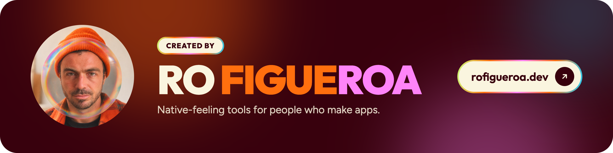

<p align="center">
  <a href="https://cal.com/rodrigo-figueroa-vmbwee/30min"></a>
</p>
<p align="center">
  <a href="https://rofigueroa.dev"></a>
</p>

# davinchi-cloud

**Your own cloud agent editor.** DaVinci Resolve running on a Daytona Linux GPU
box, with Claude Code on the same box driving it through an MCP server, and your
media and projects on persistent storage that outlives the box. The box also
includes the **fal** and **Higgsfield** MCPs for generating shots. It's set up
for Claude for now, and you can wire in another agent and subscription yourself.

Four pieces make it work:

1. **A Daytona Linux GPU sandbox.** A snapshot with Resolve installed, a
   browser desktop (Daytona Computer Use + noVNC) and VirtualGL, so Resolve's
   OpenGL UI renders on the NVIDIA card. You start a box when you edit and
   delete it when you're done.
2. **DaVinci Resolve free 21.0.3, on purpose.** Blackmagic moved Python
   scripting to Studio in **21.1**, and the free 21.1+ Scripts menu no longer
   runs Python. 21.0.3 is the last free line an agent can control, and the
   exact build the MCP's in-app bridge was measured on (21.0.3.7). A Studio
   zip works too.
3. **[davinci-resolve-mcp](https://github.com/samuelgursky/davinci-resolve-mcp)**
   by Samuel Gursky. It covers the whole Resolve scripting API, and its
   in-app bridge reaches the free edition. It's pre-installed and registered
   with Claude Code on the box.
4. **Persistent storage.** A Daytona volume holds your media, renders and
   automatic backups of Resolve's project database. Every new box starts where
   the last one stopped.

```
┌──────────── Daytona GPU sandbox (RTX PRO 6000 / L40S / RTX 4090 / 5090) ────────────┐
│ Ubuntu 22.04                                                                         │
│ Computer Use desktop: Xvfb :0 (1920x1080) + xfce4 + x11vnc + noVNC :6080             │
│ /opt/resolve  DaVinci Resolve free 21.0.3 ── vglrun -d egl ──► NVIDIA OpenGL 4.6      │
│                     ▲                   └─ CUDA / OpenCL / NVENC from the GPU runtime │
│                     │ in-app bridge (Workspace ▸ Scripts ▸ resolve_bridge)            │
│ /opt/davinci-resolve-mcp  ◄── stdio ──  Claude Code (`claude`, over `daytona ssh`)    │
│                                          + optional fal / Higgsfield MCPs             │
│ ~/media  ◄── Daytona volume "resolve-media" (persists; the GPU box is ephemeral)     │
└──────────────────────────────────────────────────────────────────────────────────────┘
```

## How it works

| Piece | Choice | Why |
|---|---|---|
| Base | `ubuntu:22.04` | apt has all the packages Daytona Computer Use needs |
| Resolve install | official `.run` → `--appimage-extract` → `AppRun -i -a -y` with `SKIP_PACKAGE_CHECK=1`, then `patchelf` to load the system glib | the [davincibox](https://github.com/zelikos/davincibox) recipe, unattended |
| Installer size | separate build stage | the ~4 GB zip doesn't end up in the final image |
| Desktop | `sandbox.computer_use.start()` | Daytona's managed Xvfb + xfce + x11vnc + noVNC |
| GPU rendering | VirtualGL 3.1 EGL back end (`vglrun -d egl`) | Xvfb has no GPU; VirtualGL renders Resolve's OpenGL on the NVIDIA card |
| Driver | injected at runtime (`NVIDIA_DRIVER_CAPABILITIES=all`) | matches whatever driver the GPU host runs |

Two Daytona quirks are handled for you (both confirmed on a live GPU box):

1. **Missing soname links.** The NVIDIA runtime mounts `libEGL_nvidia.so.<ver>`
   and `libGLX_nvidia.so.<ver>` but does not run `ldconfig`. Without the `.so.0`
   links, VirtualGL silently falls back to Mesa llvmpipe.
   `scripts/start-resolve.sh` runs `sudo ldconfig` before launching.
2. **Small default desktop.** Computer Use defaults to 1024x768. The image sets
   `VNC_RESOLUTION=1920x1080`, and `up --resolution` can override it. Resolution
   can only be set when the sandbox is created.

## Prerequisites

- Python 3.10+ and the Daytona SDK: `python3 -m venv .venv && .venv/bin/pip install -r requirements.txt`
- Daytona credentials: `DAYTONA_API_KEY`, or a logged-in `daytona` CLI (the script reads its config).
- GPU access on your Daytona org.
- The **Linux** installer from Blackmagic (registration form):
  <https://www.blackmagicdesign.com/support/family/davinci-resolve-and-fusion>
  → *DaVinci Resolve 21.0.3* (free) → **Linux**. Put the zip in `optional/`:

  ```bash
  mv ~/Downloads/DaVinci_Resolve_21.0.3_Linux.zip optional/
  ```
  **Stay on free 21.0.x, not 21.1+.** Free 21.1+ removed Python scripting, so the
  [davinci-resolve-mcp](https://github.com/samuelgursky/davinci-resolve-mcp)
  in-app bridge can't control it. The MCP validated the bridge on free 21.0.3.7
  (and on free 20.3.2 on Linux, a fallback). See [`mcp/README.md`](mcp/README.md). A Studio zip works too.
  `optional/` is git-ignored. A `.run` you already extracted works too.

## 1. Build the snapshot (once per Resolve version)

```bash
.venv/bin/python daytona_resolve.py snapshot            # name: davinci-resolve
.venv/bin/python daytona_resolve.py snapshot --replace  # rebuild after changes
```

This uploads the build context (installer included) and builds on Daytona.
Daytona snapshots take **one** GPU type: the default is `RTX-PRO-6000`, and you
can change it with `--gpu-type L40S` (or `RTX-4090`, `RTX-5090`, `H100`, ...).
RTX-class cards have NVENC; H100/H200 have no hardware H.264/H.265 encoder.

## 2. Daily use

```bash
R=".venv/bin/python daytona_resolve.py"

$R push ~/Shoots/day1 --to footage     # upload media (no GPU box needed)
$R push music.wav logo.png --to assets
$R fetch https://.../A001.mov          # server-side download straight onto the volume (fast)

$R up                                  # GPU box + desktop + Resolve, media + projects already there
$R up --claude-token                   # ...and log Claude Code in with your subscription
                                       #    (export CLAUDE_CODE_OAUTH_TOKEN=$(claude setup-token output) first)
$R up --mcp fal --mcp higgsfield       # ...also give Claude on the box the fal / Higgsfield MCPs
                                       #    (then on the box: claude mcp login fal --no-browser, same for higgsfield)
$R down                                # close Resolve, save projects, delete the box

$R pull exports/final.mov ~/Desktop    # download a render
$R ls footage                          # what's on the volume
$R status                              # boxes, volume, last project save
$R save | vnc [--restart] | verify     # save now / desktop URL / smoke test
```

`up` reuses the running box if there is one; otherwise it creates a new one
(`--new` forces a new box). Options: `--resolution 2560x1440`, `--auto-stop 120`,
`--volume <name>` (separate volume per client or project), `--no-resolve`, `--public`.

## 3. Persistent storage

GPU boxes are **ephemeral**: they are deleted on `down`, on idle auto-stop, or if
they crash. Everything worth keeping lives on the Daytona **volume**
`resolve-media`. It is created on first use and mounted at `~/media` in every box:

```
~/media/
  footage/  audio/  assets/        your media: import it in Resolve from here
  exports/                         render here
  project-archives/                .dra / .drp exports
  .resolve-state/                  automatic project-database backups (state-<UTC>.tar.gz, last 5)
```

- **Media** sits directly on the volume, so it's there as soon as any box starts.
  Media pool links to `~/media/...` keep working because the path is the same
  in every box.
- **Projects**: Resolve's database is SQLite, which can't run on a FUSE/S3
  volume. It runs on the box's local disk instead:
  - `up` restores the newest backup before Resolve starts.
  - Autosave writes a new backup every 5 minutes, only when something changed.
  - `down` closes Resolve and saves one last time.
  - At worst, a crash or idle auto-stop loses the last ≤5 minutes of edits.
- **Uploads**: `push` sends big files as 16 MB chunks over 8 parallel streams
  (about 5x faster than a single stream) and checks the MD5 afterwards. Files
  already on the volume with the same size are skipped, so re-running a push
  resumes it. With no GPU box running, `push`/`pull`/`ls` use a small CPU box
  (`resolve-storage-<volume>`), so you don't pay for a GPU while uploading.
- **Volume behaviour** (`mountpoint-s3`): sequential writes, overwrite and delete
  work, but **rename does not**. Reading is slower than local disk. For heavy
  4K/RAW timelines, generate optimized media or proxies, and keep Resolve's cache
  on the local disk (the default).

These were all tested on live Daytona GPU boxes:
- push, then a fresh `up` shows the media with matching MD5
- project data survives `down` and `up`
- an edit survives a box killed without `down`, via autosave
- pull of a file name with spaces

## The agent on the box

> **Set up for Claude for now.** The box ships with **Claude Code**, logged in
> with your Claude subscription. You can set it up for another agent and
> subscription (Codex CLI, Gemini CLI, opencode, ...): install that CLI on the
> box, log it in, and register the same MCP servers. They're plain MCPs:
> `davinci-resolve` is the stdio command `/opt/scripts/start-mcp.sh` with
> `MCP_TRANSPORT=stdio`, and fal / Higgsfield are the HTTP URLs below. The
> davinci-resolve-mcp installer can also write the config for most clients
> (`/opt/davinci-resolve-mcp/venv/bin/python /opt/davinci-resolve-mcp/install.py --clients manual`
> prints the config to paste; `--clients codex` etc. writes it).

### Included MCP servers

| MCP | What it gives the agent | How it's added | Login |
|---|---|---|---|
| `davinci-resolve` | Full Resolve scripting API: projects, media pool, timelines, color, Fusion, render ([davinci-resolve-mcp](https://github.com/samuelgursky/davinci-resolve-mcp)) | Always, baked into the image | None (free edition: the in-app bridge, step 4) |
| `fal` | fal.ai generative models: image, video, audio, 3D (`https://mcp.fal.ai/mcp-relay`) | `up --mcp fal` | OAuth, once per box |
| `higgsfield` | Higgsfield image and video generation (`https://mcp.higgsfield.ai/mcp`) | `up --mcp higgsfield` | OAuth, once per box |

With fal and Higgsfield on the same box, the agent can generate a shot and put
it on the Resolve timeline in one session.

### Step by step

1. **Make a subscription token** on your Mac (once; it's long-lived):

   ```bash
   claude setup-token                       # opens the browser, prints the token
   export CLAUDE_CODE_OAUTH_TOKEN='<token>'
   ```

2. **Start the box** with Claude logged in and the extra MCPs:

   ```bash
   $R up --claude-token --mcp fal --mcp higgsfield
   ```

   The token is written to a `0600` file on the box (`~/.claude-auth.env`), not
   into the image or the sandbox's environment variables. `up` prints the box
   name and the desktop link.

3. **Open the desktop link.** Resolve is already starting there.

4. **Start the bridge** (free edition, once per Resolve session). The free
   edition only accepts scripts from inside Resolve: open or create a project,
   then **Workspace ▸ Scripts ▸ resolve_bridge**. Until then the
   `davinci-resolve` tools return a connection error. `up` installs the bridge,
   with a fresh secret per box, before Resolve starts.

5. **SSH in and log in to fal / Higgsfield** (once per box):

   ```bash
   daytona ssh <box>
   claude mcp login fal --no-browser          # open the URL on your Mac, approve,
   claude mcp login higgsfield --no-browser   # paste the redirect URL back
   ```

6. **Run Claude** and check the servers:

   ```bash
   claude
   /mcp                                       # davinci-resolve, fal, higgsfield: connected
   ```

   Then ask for the edit, e.g. "make a project called day-1 and import
   everything in footage". `~/.claude/CLAUDE.md` on the box tells Claude where
   the media lives, how the bridge works, and never to modify source media.

7. **When you're done:** `$R down` closes Resolve, saves the projects to the
   volume and deletes the box. GPU boxes are ephemeral, so steps 4 and 5 repeat
   on the next box; your media and projects don't.

**Resolve Studio:** external scripting works directly (Preferences ▸ General ▸
External scripting using ▸ Local), so step 4 isn't needed. A Studio key allows 2
activations and every `up` is a new machine, so run Help ▸ Deactivate License
before `down`.

See [`mcp/README.md`](mcp/README.md) for the edition details.

## Layout

```
Dockerfile                          base → installer stage → final image
daytona_resolve.py                  snapshot | up | down | push | fetch | pull | ls | status | save | vnc | verify
requirements.txt                    daytona SDK
optional/                           put the Resolve Linux zip/run here (git-ignored)
scripts/install-davinci-resolve.sh  unattended install (build time)
scripts/start-resolve.sh            ldconfig fix + vglrun -d egl launcher
scripts/resolve-state.sh            project DB restore / save / autosave to the volume
scripts/verify-davinci-resolve.sh   in-box smoke test
scripts/davinci-resolve.desktop     desktop / menu launcher
scripts/install-resolve-mcp.sh      optional davinci-resolve MCP (build arg INSTALL_MCP=1)
scripts/start-mcp.sh                run the MCP server in the box (stdio for Claude Code)
scripts/setup-free-bridge.sh        install the MCP's in-app bridge (run by `up`)
scripts/claude-box.md               ~/.claude/CLAUDE.md for the agent on the box
mcp/README.md                       agent control notes
docs/readme/                        README banners
```

## Troubleshooting

- **`No installer in ./optional/`**: download the *Linux* zip (not the Mac one).
- **Resolve shows "GPU not supported" or renders slowly**: run `verify`. The GL
  line must say `NVIDIA`. If it says llvmpipe, run `sudo ldconfig` and relaunch.
- **noVNC 503 / blank**: `daytona_resolve.py vnc <id> --restart`.
- **MCP tools return a connection error**: start the bridge (Workspace ▸ Scripts
  ▸ resolve_bridge) in the open project. `/mcp` in Claude shows the server state.
- **Logs**: `/tmp/resolve.log`, `/opt/resolve/logs/`, MCP: `/opt/davinci-resolve-mcp/logs/server.log`.
